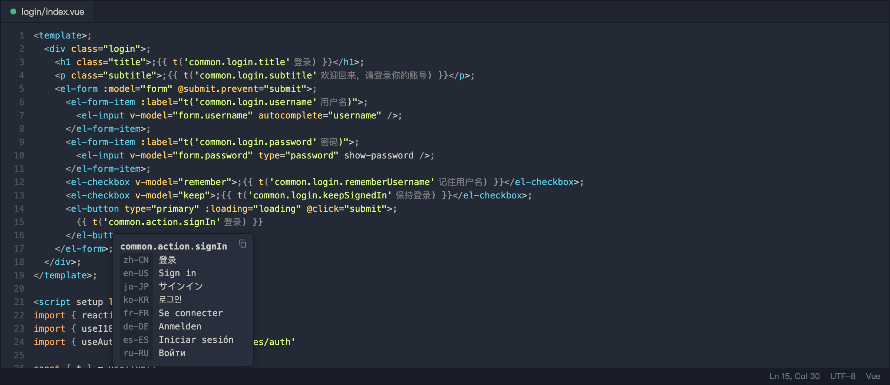
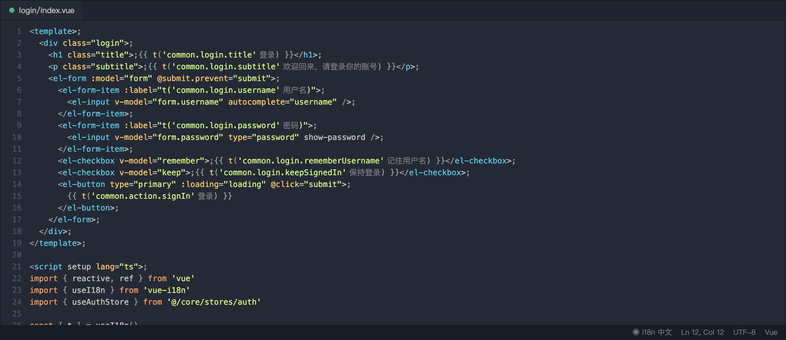
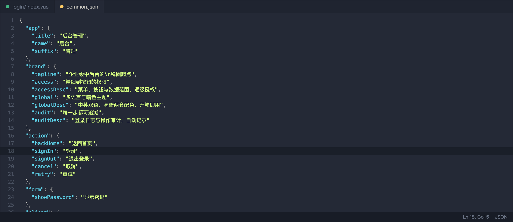
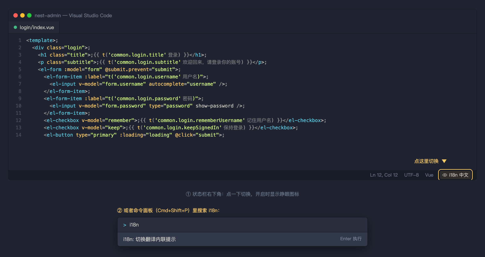

# i18n Jump

[](https://code.visualstudio.com/)
[](LICENSE)
[](https://github.com/francyfrees/vscode-i18n-jump/releases)

给 Vue / TypeScript 里的 `t('...')` 翻译键加三个能力：**悬停看文案、Cmd+点击定位词条、中文内联提示**。不依赖任何第三方扩展。







## 功能

| 能力 | 触发方式 | 效果 |
| --- | --- | --- |
| 悬停 | 鼠标停在 `t('...')` 上 | 按顺序列出所有已配置语言的文案；鼠标移到弹层上可用右上角自带的复制按钮 |
| 跳转 | `Cmd + 点击` | 打开中文词条所在文件与行 |
| 内联回显 | 默认开启，状态栏「i18n 中文」可切换 | 在 `t('...')` 后面显示中文，超过 15 字显示 `…` |

支持 `t('...')`、`$t('...')`、`i18n.global.t('...')` 三种写法。

### 中文内联开关

内联提示**默认开启**，两种切换方式（状态按工作区记住）：



- 点状态栏右下角的 **`◐ i18n 中文`**；
- 或在命令面板（`Cmd+Shift+P`）执行 **`i18n: 切换翻译内联提示`**。

保存任意 locale 文件后缓存自动失效并刷新内联提示。

命令面板里还有 `i18n: 切换翻译内联提示`，可以自己绑快捷键：

```jsonc
{ "key": "cmd+alt+i", "command": "i18nJump.toggleInline" }
```

## 安装

从 [Releases](https://github.com/francyfrees/vscode-i18n-jump/releases) 下载最新的 `.vsix`：

```bash
code --install-extension i18n-jump-*.vsix
```

或者从源码打包安装：

```bash
git clone https://github.com/francyfrees/vscode-i18n-jump.git
cd vscode-i18n-jump
./build.sh
```

只依赖 `zip` 与 `code` 命令，不需要联网。装完在 VS Code 执行一次 **Developer: Reload Window**。

更新同理：改完 `extension.js` 或 `package.json` 里的 `version`，重新 `./build.sh`。

卸载：扩展面板搜 `i18n Jump` → Uninstall。

## 支持的词条位置

按 `mergeLocaleFile`（`packages/shared/src/common/locale.ts`）的规则，扩展会同时查：

- `apps/web/src/locales/<lang>/`
- `packages/shared/src/i18n/<lang>/`
- `packages/shared/src/i18n/<lang>/modules/`
- `apps/server/src/i18n/<lang>/`

文件名带点（`agent.chat.json`）时存完整键；不带点（`common.json`）时去掉第一段。扩展两种都试，所以不需要记规则。

例如：

| 键 | 命中位置 |
| --- | --- |
| `common.action.signIn` | `apps/web/src/locales/zh-CN/common.json:18` |
| `agent.chat.layout.resizeHint` | `apps/web/src/locales/zh-CN/agent.chat.json:406` |
| `field.iam.role.name` | `packages/shared/src/i18n/zh-CN/modules/iam.role.json:5` |
| `error.iam.grant_exceeds_own` | `apps/server/src/i18n/zh-CN/error.json:58` |

## 配置

三个设置都在 VS Code 设置里搜 `i18n Jump` 修改。默认值就是本仓库的布局，**不配也能用**：

语言数量不限，数组里有几个就查几个，悬停按顺序全部列出（上方截图里演示了 8 种）。

```jsonc
{
  // 语言目录名，第一个是默认语言
  "i18nJump.languages": ["zh-CN", "en-US"],

  // 词条目录，{lang} 替换为语言名
  "i18nJump.localePaths": [
    "apps/web/src/locales/{lang}",
    "packages/shared/src/i18n/{lang}",
    "packages/shared/src/i18n/{lang}/modules",
    "apps/server/src/i18n/{lang}"
  ],

  // 内联提示最多显示多少字
  "i18nJump.inlineMaxLength": 15
}
```

换到别的项目只改前两项：

```jsonc
{
  "i18nJump.languages": ["zh-CN", "en"],
  "i18nJump.localePaths": ["src/locales/{lang}", "locales/{lang}"]
}
```

改了设置立即生效（缓存会清空并刷新内联提示），不用重载窗口。

## 已知限制

- 文件**命名约定**仍按本项目：文件名带点（`agent.chat.json`）时存完整键，不带点（`common.json`）时去掉第一段。扩展两种都试，但只要不是这两种约定就找不到；
- 只解析单行内的 `t('...')`，跨行书写（`t(\n  'key'\n)`）不会命中；
- 多定义时固定跳默认语言（`languages` 的第一个）；
- 内联提示落在右引号之后、`)` 之前：`t('key' 文案)`；
- VS Code 扩展宿主只支持 CommonJS，因此文件顶部有一条 `eslint-disable` 注释，属于预期写法。

## 项目结构

```
tools/vscode-i18n-jump/
├── extension.js   # 全部逻辑：解析、缓存、Hover / Definition / InlayHints
├── package.json   # 扩展清单
├── build.sh       # 打包 vsix 并安装
└── docs/          # README 用图
```

## License

[MIT](LICENSE) © 2026 mingliangqiang
